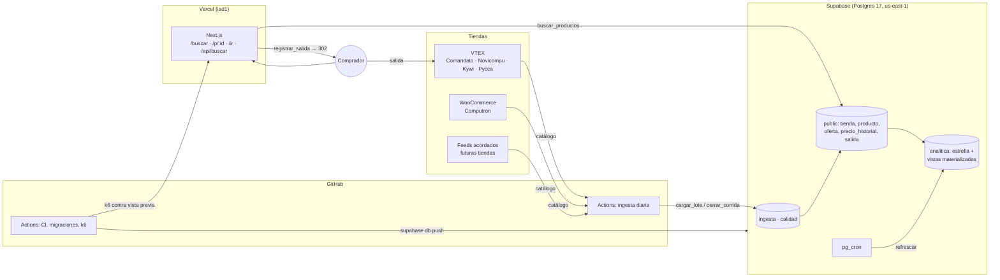
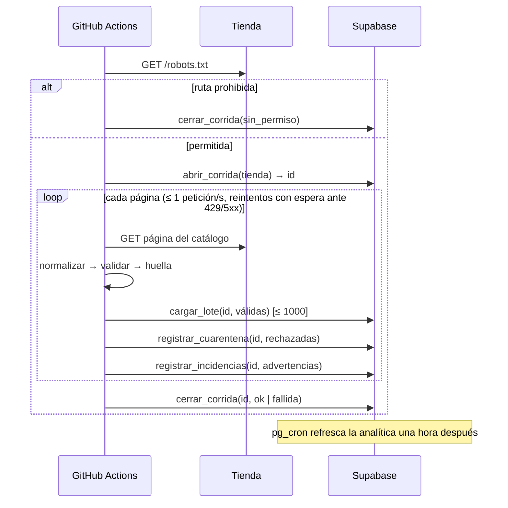
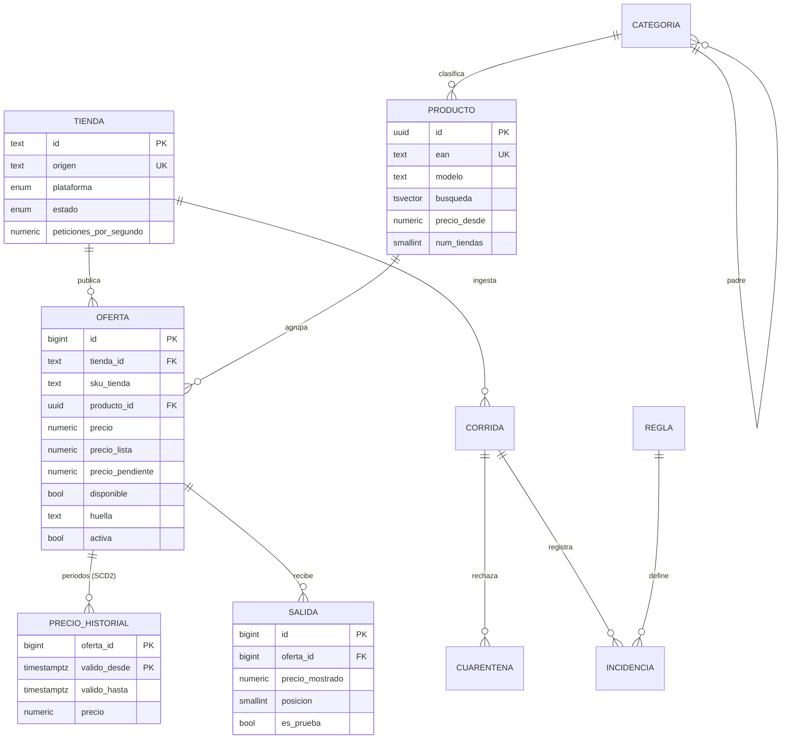

# Arquitectura de DecideAqui

Estado: propuesta del 6 de noviembre de 2026. Las decisiones con alternativas reales están en [docs/adr](adr/), el vocabulario en [GLOSSARY.md](../GLOSSARY.md).

## 1. Punto de partida

El prototipo (`src/`) consulta las tiendas en vivo en cada búsqueda. Funciona, pero no guarda historial, no escala con el tráfico y tarda lo que tarde la tienda más lenta. En la prueba k6 con caché fría hubo búsquedas de hasta 8 segundos.

Volumen medido el 6 de noviembre de 2026 (una petición por tienda):

| Tienda | Plataforma | Productos | KB por producto (JSON) |
|---|---|---:|---:|
| Kywi | VTEX | 31.435 | 10,6 |
| Pycca | VTEX | 9.164 | 18,1 |
| Novicompu | VTEX | 3.023 | 30,9 |
| Computron | WooCommerce | 1.305 | 12,7 |
| Comandato | VTEX | 321 | 29,7 |
| **Total** | | **≈ 45.000** (≈ 55.000 ofertas contando variantes) | |

Consecuencias directas:

- Una corrida completa son unas 900 páginas. A 1 petición por segundo por tienda tarda unos 11 minutos (Kywi marca el ritmo).
- Guardar la respuesta cruda ocuparía unos 900 MB por corrida. El plan gratuito de Supabase tiene 500 MB, así que no se guarda (ADR 0003).
- Si en un día cambia de precio el 5 % de las ofertas, son unos 2.750 periodos de historial nuevos. En un año son menos de 1 millón de filas.

## 2. Vista general



## 3. Ingesta de datos

### 3.1 Fuentes

| Fuente | Cómo se lee | Paginación | Límites |
|---|---|---|---|
| VTEX | `GET /api/catalog_system/pub/products/search?fq=C:/{categoría}/&_from=&_to=` | 50 por página | VTEX corta en `_from` 2.500: se recorre por categoría (árbol en `/api/catalog_system/pub/category/tree/3`) |
| WooCommerce | `GET /wp-json/wc/store/v1/products?page=&per_page=100` | 100 por página | Cabeceras `X-WP-Total` y `X-WP-TotalPages` |
| Feed | CSV o JSON en una URL que la tienda publica | Archivo completo | Es el camino previsto para nuevas tiendas, como en idealo |

### 3.2 Una corrida, paso a paso



`cargar_lote` hace todo el trabajo en una sola llamada:

1. Empareja cada oferta con un producto. Respeta los emparejamientos manuales, luego busca por EAN y luego por código de modelo. Si no encuentra nada, crea un producto propio.
2. Detecta saltos de precio de más del 70 %: conserva el precio anterior y deja el nuevo pendiente.
3. Hace upsert por `(tienda_id, sku_tienda)`. Un disparador escribe el historial solo si cambian el precio, el precio de lista o la disponibilidad.
4. Recalcula el precio desde y el número de tiendas de los productos afectados.

`cerrar_corrida` desactiva las ofertas que faltaron en dos corridas seguidas. Si la corrida leyó menos de la mitad que la anterior, no desactiva nada y la marca `parcial`.

### 3.3 Módulos del worker (`packages/ingesta`)

Diseño de módulos profundos (`/codebase-design`): interfaz pequeña, mucha lógica detrás y dos seams reales, cada uno con al menos dos adaptadores.

```ts
// Seam 1. Adaptadores: vtex, woocommerce, feed.
interface Fuente {
  leer(tienda: Tienda, señal: AbortSignal): AsyncIterable<OfertaCruda[]>; // una página por iteración
}

// Seam 2. Adaptadores: postgres (producción) y memoria (pruebas).
interface Almacen {
  abrirCorrida(tiendaId: string): Promise<number>;
  cargar(corridaId: number, lote: Lote): Promise<Conteo>; // válidas + cuarentena + advertencias
  cerrar(corridaId: number, estado: EstadoCorrida, error?: string): Promise<ResumenCorrida>;
}

// Módulo profundo: lo único que llama el workflow.
function ejecutarCorrida(tienda: Tienda, deps: { fuente: Fuente; almacen: Almacen; reloj?: Reloj }): Promise<ResumenCorrida>;

// Funciones puras (paquete dominio), probadas sin red ni base:
function validar(cruda: OfertaCruda, tienda: Tienda): Validacion; // 'valida' + advertencias | 'cuarentena' + reglas
function claveDeProducto(o: OfertaValida): { ean?: string; modelo?: string };
function huella(o: OfertaValida): string;
```

El emparejamiento y la extracción del código de modelo ya existen y tienen pruebas en `src/agrupar.mjs`. Pasan al paquete `dominio` sin cambiar su comportamiento.

## 4. ¿OLTP, OLAP o ROLAP?

Hay dos cargas de trabajo distintas, y las dos caben en un mismo Postgres (ADR 0002).

| | Operación (OLTP) | Análisis (ROLAP) |
|---|---|---|
| Quién | Compradores en la web, worker de ingesta | Equipo, tiendas, informe de prácticas |
| Consultas | Buscar, ver ficha, registrar salida, upsert de ofertas | Índice de precios semanal, salidas por tienda, competitividad |
| Forma | Muchas lecturas cortas por índice, escrituras por lotes una vez al día | Agregados sobre historial y salidas |
| Modelo | Normalizado (3FN) en `public` | Estrella en `analitica`: dimensiones fecha, tienda, categoría y producto; hechos `precio_historial` (SCD2) y `salida` |
| Frescura | Inmediata | Vistas materializadas refrescadas por pg_cron 2 h después de la corrida diaria |

Es ROLAP porque el cubo se resuelve con SQL sobre tablas relacionales. Descartamos MOLAP (cubos precalculados) porque los agregados son pocos y caben en vistas materializadas de miles de filas. También descartamos un almacén aparte: el umbral para reconsiderarlo es de 50 millones de filas de hechos o 2 segundos de p95 en consultas analíticas.

## 5. Diseño de la base de datos



Migraciones en [supabase/migrations](../supabase/migrations/):

| Archivo | Contenido |
|---|---|
| `…0100_base.sql` | pg_trgm, unaccent, búsqueda en español sin acentos, tipos enumerados |
| `…0200_catalogo.sql` | Tablas OLTP, índices, disparador de historial y `recalcular_productos` |
| `…0300_ingesta_calidad.sql` | Corridas, cuarentena, reglas e incidencias; `cargar_lote`, `cerrar_corrida` y retención |
| `…0400_seguridad_api.sql` | RLS, `buscar_productos` y `registrar_salida` |
| `…0500_analitica_rolap.sql` | Dimensiones, vistas materializadas y tareas de pg_cron |

Seguridad:

- La web pública usa la clave publicable. Solo puede leer tiendas activas, productos con ofertas, ofertas activas e historial.
- Las salidas solo se escriben con `registrar_salida`, que toma la URL de la base y comprueba que sea del dominio de la tienda. Así `/ir` no puede usarse como redirección abierta.
- El proyecto de Supabase se crea sin "Automatically expose new tables" y con "Enable automatic RLS". Cada permiso de `anon` se concede a mano en la migración 0400: solo SELECT en las tablas públicas de lectura y EXECUTE en `buscar_productos` y `registrar_salida`. Las funciones internas tienen EXECUTE revocado.
- Los esquemas `ingesta`, `calidad` y `analitica` no son accesibles con las claves de API. El worker entra con la cadena de conexión de Postgres.

Tamaño estimado en el primer año: unos 100 MB entre ofertas e índices, menos de 200 MB de historial e incidencias de calidad con 90 días de retención. Cabe en el plan gratuito, pero ojo: un proyecto gratuito se pausa tras una semana sin actividad. La ingesta diaria lo mantiene activo.

## 6. Calidad de datos

Cuatro barreras, de la más barata a la más tardía:

1. **Forma.** El worker valida la estructura de cada respuesta con Zod. Si la plataforma cambia su API, la corrida falla entera en vez de cargar basura.
2. **Reglas por oferta.** `validar()` aplica las reglas del catálogo `calidad.regla`. Una regla bloqueante manda la oferta a cuarentena con su payload. Una advertencia la deja pasar y la anota.
3. **Restricciones en la base.** Los CHECK (precio entre 0 y 100.000, precio de lista mayor que el precio, URL https, EAN numérico) son la última barrera aunque el worker tenga un error.
4. **Controles por corrida.** El corte por caída de volumen, la confirmación de saltos de precio, la desactivación solo tras dos ausencias y la frescura por tienda (pg_cron cada hora).

| Regla | Dimensión | Severidad |
|---|---|---|
| precio_invalido, moneda_no_usd, url_fuera_de_tienda | validez | bloqueante |
| titulo_vacio, sku_ausente | completitud | bloqueante |
| sku_duplicado | unicidad | advertencia |
| ean_invalido, precio_lista_menor | validez / consistencia | advertencia (se corrige el dato) |
| sin_imagen, sin_emparejar | completitud / consistencia | advertencia |
| salto_precio | consistencia | advertencia (se publica al confirmarse) |
| caida_de_volumen | completitud | advertencia (corrida `parcial`) |
| tienda_desactualizada | frescura | advertencia |

Seguimiento: `calidad.resumen_corrida` muestra por corrida las leídas, las válidas, el porcentaje válido, las desactivadas y las incidencias por regla. La página `/tiendas` publica la última actualización y el porcentaje válido de cada tienda. Retención: la cuarentena se guarda 30 días y las incidencias 90.

## 7. Stack tecnológico

| Capa | Elección | Alternativas consideradas | Motivo |
|---|---|---|---|
| Lenguaje | TypeScript estricto, Node.js 24 LTS | JavaScript (prototipo), Python | Tipos compartidos entre web, worker y dominio |
| Web | Next.js con App Router | Astro, SvelteKit, React Router 7 | SEO con renderizado en servidor e ISR, route handlers, integración con Vercel (ADR 0005) |
| UI | Tailwind CSS 4 + componentes propios | shadcn/ui completo, MUI | Pocas pantallas; sin librería pesada |
| Base de datos | Supabase Postgres 17 | Neon, PlanetScale, Firebase | RLS, pg_cron, CLI de migraciones y plan gratuito; pedido por el proyecto |
| Acceso a datos (web) | supabase-js + tipos generados (`supabase gen types`) | Prisma, Drizzle | La lógica está en funciones SQL; el cliente solo llama RPC y lee vistas |
| Acceso a datos (worker) | postgres.js por el pooler de sesión | supabase-js | Lotes grandes y transacciones; sin pasar por la API REST |
| Validación | Zod 4 | Valibot, io-ts | Estándar de facto, inferencia de tipos |
| Búsqueda | Postgres FTS (español sin acentos) + pg_trgm | Algolia, Meilisearch, Elasticsearch | 45 mil fichas no justifican otro servicio (ADR 0006) |
| Programación | GitHub Actions (ingesta) + pg_cron (analítica, retención) | Vercel Cron, Supabase Edge Functions | Corridas de 11 min (ADR 0004) |
| Repositorio | GitHub, monorepo con npm workspaces | pnpm + Turborepo | Tres paquetes; sin herramienta extra hasta que haga falta |
| Despliegue web | Vercel, región iad1 | Netlify, Cloudflare | Vistas previas por pull request, cercanía a la base |
| Pruebas | Vitest (unidad), PGlite (SQL), Playwright (humo de UI), k6 (carga) | Jest, Docker + Postgres | Rápidas y sin Docker en CI para SQL |

## 8. Repositorio y entornos

Estructura objetivo (el prototipo actual se mueve a `prototipo/` al crear `apps/web`):

```
comparador-ecuador/
├── apps/web/              Next.js: /, /buscar, /p/[id], /tiendas, /ir, /api/buscar
├── packages/dominio/      validar, claveDeProducto, huella (puro, sin dependencias)
├── packages/ingesta/      ejecutarCorrida + adaptadores Fuente y Almacen
├── supabase/              migrations/, seed.sql, config.toml
├── tests/carga/           k6: humo, carga, estrés, pico
├── scripts/               validar-esquema.mjs, wizard-configuracion.sh
├── docs/                  arquitectura.md, adr/
└── .github/workflows/     ci, migraciones, ingesta, carga-k6
```

| Entorno | Web | Base | Cuándo |
|---|---|---|---|
| Local | `npm run dev` | PGlite (pruebas) o `supabase start` con Docker | Siempre |
| Vista previa | Vercel por pull request | Proyecto Supabase de producción en solo lectura, o rama de Supabase (plan Pro) | Cada pull request; k6 a mano al final del proyecto |
| Producción | Vercel en `main` | Supabase `us-east-1` | Al fusionar en `main` |

## 9. Pruebas

| Nivel | Herramienta | Qué cubre | Estado |
|---|---|---|---|
| Unidad | node:test hoy, Vitest en los paquetes | Emparejamiento, normalización, redirector, reglas de calidad | 8/8 en el prototipo |
| Base de datos | PGlite (`npm run validar:esquema`) | Migraciones, emparejamiento, saltos de precio, desactivación, corte de seguridad, cuarentena, RLS y permisos de anon, búsqueda con tildes y errores de tipeo, ROLAP | 34/34 |
| Carga | k6 (`tests/carga`) | Humo, carga, estrés y pico sobre `/api/buscar` e `/ir` (sin seguir la redirección a tiendas) | 4/4 escenarios y 17/17 umbrales contra Vercel + Supabase (`pruebas/k6-vercel.txt`) |

Umbrales de k6:

| Escenario | Perfil | Umbrales |
|---|---|---|
| humo | 1 usuario, 30 s, en cada vista previa | errores < 1 %, búsqueda p95 < 800 ms, salida p95 < 300 ms |
| carga | hasta 50 usuarios, 5 min | búsqueda p95 < 500 ms y p99 < 1,2 s, salida p95 < 250 ms |
| estrés | escalones hasta 300 usuarios | se aborta si los errores pasan de 10 %; búsqueda p95 < 2 s |
| pico | 10 → 400 búsquedas por segundo en 30 s | errores < 2 %, búsqueda p95 < 1,5 s, < 100 iteraciones descartadas |

Resultados contra la vista previa de Vercel (6 nov 2026, Supabase de producción, 0 peticiones fallidas en 48.378):

| Escenario | Perfil corrido | Búsqueda p95 | Peticiones |
|---|---|---|---|
| humo | 1 usuario, 30 s | 233 ms (salida 244 ms) | 39 |
| carga | 50 usuarios, 5 min | 229 ms, p99 303 ms (salida 218 ms) | 5.183 |
| estrés | escalones hasta 100 usuarios (`VUS=100 ESCALON=1m`) | 250 ms | 28.784 |
| pico | 10 → 100 búsquedas/s (`RPS=100 MESETA=1m`) | 419 ms, 20 iteraciones descartadas | 14.372 |

Estrés y pico se corrieron con topes reducidos porque la vista previa comparte la base de producción y el plan gratuito de Supabase.

Reglas de las pruebas de carga: nunca contra producción (el script lo impide), cabecera `X-Prueba-Carga` para marcar las salidas como `es_prueba`, y la redirección a la tienda no se sigue. Así no se carga a las tiendas ni se generan clics falsos.

## 10. CI/CD

| Workflow | Disparador | Hace |
|---|---|---|
| `ci.yml` | pull request y push a main | `npm test`, `validar:esquema` y sintaxis de k6 |
| `migraciones.yml` | push a main que toca `supabase/migrations` | `supabase db push --db-url` por el Session pooler, sin token de Supabase (entorno `produccion`) |
| `ingesta.yml` | manual; el cron `17 */6 * * *` está comentado hasta que exista `packages/ingesta` | Corrida de todas las tiendas activas |
| `carga-k6.yml` | solo manual | Humo, carga, estrés o pico contra una vista previa. Se ejecutan al final, con todo el sistema listo |

Secretos de GitHub (los crea `scripts/wizard-configuracion.sh`): solo `DATABASE_URL` y `VERCEL_AUTOMATION_BYPASS_SECRET`. Las migraciones usan `supabase db push --db-url` en lugar de `supabase link`, así que no hace falta un token de acceso de Supabase, que caducaría y daría permisos sobre la cuenta. El resto de valores (claves de API, contraseña, ref del proyecto) queda en `.env` y en las variables de entorno de Vercel.

## 11. Riesgos y preguntas abiertas

- **Uso comercial.** Vercel Hobby no lo permite. Si el comparador cobra por salidas, hay que pasar a Vercel Pro y, probablemente, a Supabase Pro (sin pausa por inactividad y con ramas para las vistas previas).
- **Cambios en las APIs de las tiendas.** VTEX y WooCommerce son estables, pero una tienda puede cerrar su catálogo público. La validación con Zod lo detecta y la corrida falla de forma visible.
- **Permisos.** Antes de abrir el sitio al público conviene avisar a las tiendas y ofrecerles el feed. Es el modelo de idealo y el único que escala a tiendas sin VTEX ni WooCommerce (Artefacta, Tía, Jaher).
- **Calidad del emparejamiento.** El código de modelo funciona con electrónica, pero no con ferretería ni hogar (Kywi y Pycca). Hará falta emparejamiento manual o por categoría para esos rubros.
